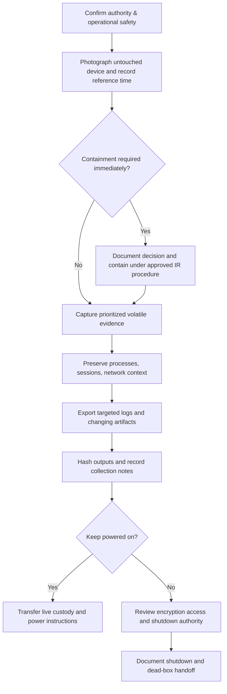
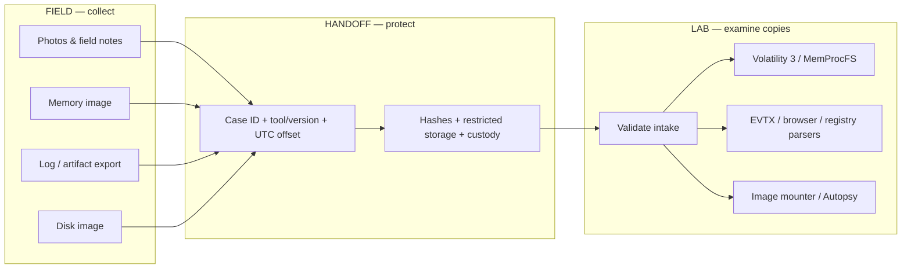

# Rapid Collection — Visual Field Reference

**Use case:** triage | acquisition | response  
**Environment:** windows | linux | macos  
**Risk:** caution

> The diagrams illustrate *authorized* collection priorities. They do not override safety, legal scope, containment requirements, or local evidence SOPs.

## Live-to-dead-box flow

**Interpretation:** Memory capture, live-system queries and containment can change order based on active destructive behavior, hardware stability, encryption, and incident severity. The diagram is not a strict stopwatch.

## Field-to-lab evidence lanes

## Predeployment checks

- [ ] Camera/approved photography method and note forms ready.
- [ ] Separate tool USB and acquisition SSD tested.
- [ ] Power, correct adapters, and spare media accounted for.
- [ ] RAM capture tool works on representative systems; lab can read test output.
- [ ] Encryption/recovery escalation path available if device is unlocked.
- [ ] Collection hashes, errors, and handoff location documented.

## Quick navigation

- [Rapid evidence collection procedure](0-rapid-evidence-collection.md)
- [Collection bag](2-collection-bag-checklist.md)
- [Field-to-lab tool matrix](4-field-to-lab-tool-matrix.md)
- [Windows collection commands](../../snippets/powershell/README.md)
- [Visual style](../../docs/visual-style.md)
